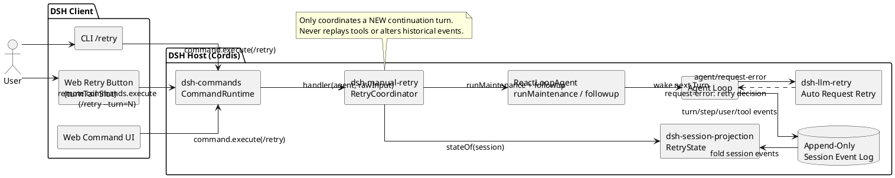
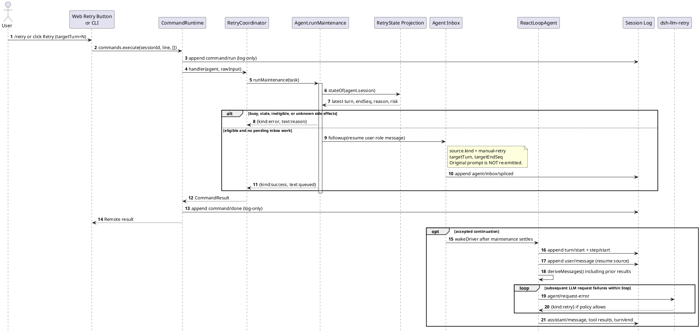
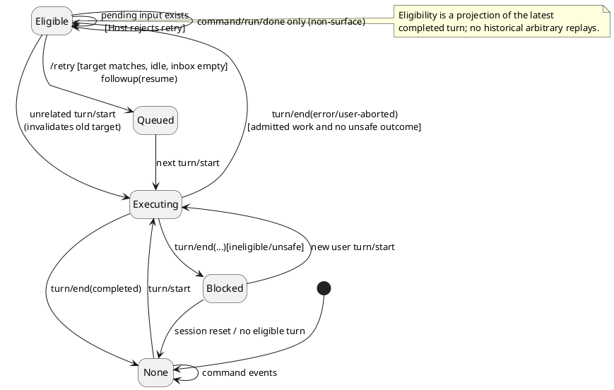
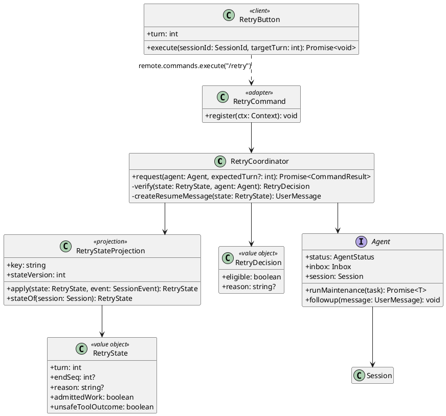

# DeepSeek Harness 插件版 `/retry` + Web Retry 按钮：技术设计规范

**状态**：Proposed for implementation（尚未实现、尚未运行仓库测试）  
**设计目标**：Plugin-first Manual Task Continuation；复用官方 `dsh-llm-retry`。  
**代码核对基线**：`deepseek-ai/deepseek-harness` `master@ce7073d51254c26cd63b22a60835b8f948deb447`（2026-10-29），以及 `dsh-v0.2.1-rc.2` / `dsh-v0.2.1-rc.5` 相关接口。  
**实施优先级**：先针对本地安装的 DSH 版本（例如 rc.2）实现，保留主分支兼容适配层。

> 本文区分三种“重试”：①在打开的 ReAct Step 内自动重试 LLM（原生已有）；②在失败 Turn 结束后手动发起一个新 Continuation Turn（本方案）；③不新增模型输入而重放上一次 Assistant/Tool Step（需改内核，本期不做）。不能把②宣传成③。

## 1. 背景、现状与问题边界

用户希望把 OMP 的可恢复执行体验引入 DSH：模型服务 429/503、SSE 中断、连接失败、默认自动重试耗尽或用户主动中断之后，不再手工复制原始 Prompt，而是通过 `/retry` 或失败位置的 Retry 按钮继续当前任务。

DSH 当前已有：

- `ReactLoopAgent.step()` 的 `agent/request-error` Waterfall；当策略返回 `{ kind: 'retry' }` 时在当前打开的 Step 内再次请求 LLM，保留前面已提交的历史。
- 官方 `@deepseek-ai/dsh-llm-retry` 插件：读取 Provider 的 `retryPolicy`、有界退避、持久化 `llm/retry`/`llm/retry-started`，默认 normal 模式最多五次重试（适用于配置的错误类别）。默认 Base Bundle 已包含此插件。
- `ctx.commands.register()`：Host slash command，不发送命令文本给模型。`ctx.remote.commands.execute(sessionId, line, [])`：现成的 Web-to-Host Command 远程入口。
- `Agent.followup()`：将新的 user-role 消息加入 next-turn 队列并唤醒 Agent；`Agent.runMaintenance()`：从真实 idle 状态独占一个非 Turn 维护窗口，阻止并发命令调度。
- `Session` Append-Only Event Log、`SessionProjection`、`conversation.chat.turnTail` UI Slot，以及失败 Turn 的 `turn/end` 原因。

目前没有公开的 `Agent.continue()`/`Agent.retry()`，因此已结束的失败 Turn 不能从前一个 Assistant Step **无输入**续跑。新插件采用带专用来源标识的短 Resume 消息，创建下一 Turn 并复用之前的 Session Surface。

## 2. 需求

| ID | 要求 | 验收条件 |
|---|---|---|
| FR-01 | 主动输入 `/retry` | 在可恢复的最近一次失败 Turn 上接受操作，不回发原始用户 Prompt。 |
| FR-02 | Web Retry 按钮 | 按钮显示在**最近**失败/用户中止 Turn 的底部，即使没有成功 Assistant 消息。 |
| FR-03 | 统一行为 | 命令和按钮均调用 `dsh-commands` 的同一个 Host Handler；没有另一套客户端恢复策略。 |
| FR-04 | 复用自动重试 | 现有 `dsh-llm-retry` 保留，插件不再创建第二个自动网络重试器。 |
| FR-05 | 状态保护 | 仅允许最近终止 Turn；拒绝旧按钮、已有新 Turn、正运行/维护中的 Agent、待处理 Inbox 消息。 |
| FR-06 | 最小上下文变化 | 只追加一个短的 model-visible Resume 消息；不修改旧 User/Assistant/Tool 消息和原始命令。 |
| FR-07 | 复现与追踪 | Command `command/run`/`command/done`、Resume `user/message.source`、新 `turn/start` 可追踪；按钮刷新/页面重载状态正确。 |
| FR-08 | 工具安全 | 不直接重放 Tool Batch；检测 `TOOL_OUTCOME_UNKNOWN` 等不确定副作用，默认拒绝自动续跑并解释原因。 |
| FR-09 | 拒绝与反馈 | 不符合条件返回可读错误；按钮有 busy、禁用及失败提示，不谎报模型已恢复成功。 |
| FR-10 | 版本边界 | 本地 DSH 与主分支的 Projection API 由独立 Adapter 适配，测试时明确目标版本。 |
| NFR-01 | 安全 | 不伪造 `MessageSource.kind='user'`；不绕过 Session Remote 权限、现有 Tool Guard、模型选择和用户批准。 |
| NFR-02 | 并发 | 单一 Session 不能在同一个失败目标上重复排队；不因异步竞态抢占正在运行的 Turn。 |
| NFR-03 | 性能 | 普通正常 Turn 仅有轻量 Session Projection fold；绝不为每个按钮点击全量读取历史、重新摘要或创建独立模型请求。 |
| NFR-04 | 可维护性 | 主体作为 Host/Client 两个插件提供；不依赖 `ReactLoopAgent` 私有字段和危险内部 import。 |

### 非目标

- 不支持任意历史 Turn、某个 Step、单个 Tool Call 的选中重放。
- 不支持基于消息历史的删改或恢复外部文件/数据库副作用。
- 不修改 `dsh-llm-retry` 的重试错误分类、预算或其 Waterfall 注册顺序。
- 不承诺上下文语义、KV Cache、Token 消耗和工具效果与 OMP 的无输入 Continue 完全相同。
- 本期不处理进程退出造成的 `turn/end(interrupted)` 自动恢复、跨进程中的未确认执行结果和 subagent 的手动恢复。

## 3. 精确语义与事件序列

1. 进行中：正常 `turn/start` → `step/start` → LLM。Provider 失败由 `dsh-llm-retry` 自动处理；插件版 `/retry` 不介入这一过程。
2. 失败且自动恢复耗尽：`assistant/attempt` 记录失败尝试；`step/end` 和 `turn/end(reason.kind='error')` 关闭 Turn，Agent 进入 Idle。
3. 用户操作 `/retry` 或 Web 按钮：Host 检查最近失败事件、任务已持久化、无并发工作和无危险未知副作用，然后 `agent.followup()` 一个新的 **user-role + source.kind='manual-retry'** 消息。
4. 新 Driver 形成新的 `turn/start` 与 `user/message`，模型请求以已提交历史 + 新恢复指令为基础，进入后续 ReAct Step。原用户消息只保存一次，之前已执行的工具结果也只保存一次。
5. 如果新 Turn 又发生 Provider 瞬态故障，普通 `dsh-llm-retry` 仍在其 Step 内工作；新 Turn 结束失败后，用户可再次主动 `/retry`（基于新的失败目标）。

**语义对外表述**：“继续上次失败的任务（使用当前历史）”，不称“原调用断点重放”、“无额外模型输入”或“无副作用精确重试”。命令 Handler 成功只表示 *queued*，不能表示新 Turn 已完成。

## 4. UML：组件图



## 5. UML：交互时序图



## 6. UML：状态机与领域模型

状态机：



领域类图：



## 7. Host 端模块与公开接口

建议新建两个扩展包，名称仅为建议，必须遵循本地 DSH 目录与 plugin 配置约定：

```text
packages/extensions/dsh-manual-retry/           # Host plugin
  src/index.ts                                  # Cordis apply + commands.register
  src/retry-coordinator.ts                      # 验证、原子请求、Resume 消息
  src/projection.ts                             # Session 事件折叠
  src/types.ts                                  # 领域状态、MessageSource 类型
  tests/retry-command.spec.ts
  tests/retry-projection.spec.ts
  tests/integration.spec.ts
packages/client/ui-manual-retry/                # Browser client plugin
  src/client/index.ts                           # turnTail Slot 注册 + Remote 依赖
  src/client/RetryTurnAction.tsx                 # 按钮、禁用、loading、error
  src/client/locales.ts                         # 文案/i18n
  tests/retry-turn-action.client.spec.tsx
```

建议内部接口：

```typescript
interface RetryTarget {
  turn: number;
  endSeq: number;
  reason: 'error' | 'user-aborted';
  hasAdmittedWork: boolean;
  unsafeOutcome: boolean;
}
interface RetryDecision {
  eligible: boolean;
  reason?: 'BUSY' | 'STALE_TARGET' | 'NO_FAILED_TURN' |
    'NO_REPLAYABLE_INPUT' | 'PENDING_INPUT' | 'UNSAFE_TOOL_OUTCOME' |
    'UNSUPPORTED_ORIGIN' | 'CANCELLED';
  target?: RetryTarget;
}
interface RetryCoordinator {
  request(agent: Agent, expectedTurn?: number, signal?: AbortSignal): Promise<CommandResult>;
}
```

注意：`CommandResult` 实际只暴露 `kind: 'success'|'error'` 与文本等信息。上述领域 `reason` 是插件内部分类，**不是** DSH 现有的 RPC 错误码。想让客户端得到结构化领域错误必须新增 Domain Remote；本期保持 `commands.execute`，通过可读 `text` 反馈。

### 7.1 Session Projection 数据模型

推荐 `manualRetry` 投影：对每个 Session 的最近 Turn 独立折叠状态，数据由 Session Event 驱动。字段示例：

```typescript
interface ManualRetryState {
  lastTurn: number | null;
  open: boolean;
  endSeq: number | null;
  reason: 'error' | 'user-aborted' | 'other' | null;
  hasAdmittedWork: boolean;
  unsafeToolOutcome: boolean;
}
interface ManualRetryView {
  targetTurn: number;
  endSeq: number;
  eligibleByHistory: boolean;  // 运行态 busy/inbox/权限由 Host 动态验证
  reason?: string;
}
```

建议折叠：

- `turn/start`：清除前一个 Eligible，重置该 Turn 的 `hasAdmittedWork`、`unsafeToolOutcome`，记录新 `lastTurn` 和 `open=true`。
- 同一个 Turn 的 `user/message`：标记存在真正进入模型历史的任务输入。仅限在 Agent Turn 内已获接纳的消息，不能用原始 Inbox 排队事件代替。
- 同一个 Turn 的 `tool/call`/`tool/result`：记录异常工具结算风险；特别关注 `TOOL_OUTCOME_UNKNOWN`、已执行后的 `ABORTED`、`TOOL_TIMEOUT`，而 `TOOL_NOT_STARTED`/`ABORTED_BEFORE_DISPATCH` 不代表工具已经产生副作用。
- `turn/end`：在已关闭且有已提交任务的前提下，仅对 `reason.kind='error'` 与 `reason.kind='aborted' && reason.reason.kind='user'` 建立候选目标；其他原因不候选。
- `command/run` / `command/done`、`assistant/attempt`、`llm/retry` 及其他无关事件：不应冲掉当前失败资格。
- 新 `turn/start` 即刻让上一个 Retry 按钮过期；投影只保留最近 Turn 的候选信息，不提供历史随意恢复。

投影状态必须是 JSON-safe、纯同步 fold，且 unrelated event 返回原状态引用。UI 使用 Client-visible `wire.view`（如果注册到 `SessionProjectionMap`，类型 augmentation 位于 `@deepseek-ai/dsh-session-projection/types`），Host 使用同步 read handle。Web 的 `eligibleByHistory` 只用于展示，**不能成为授权凭据**。

### 7.2 重要版本适配

**rc.2 / rc.5**：`ctx.sessionProjections.register(definition)` 是同步可释放的 effect/disposer；旧式 `ctx.sessionProjections.stateOf(session, key)` 为该版本主路径。

**最新 master**：`await ctx.sessionProjections.register(definition)` 返回一个 `ProjectionHandle`，通过 `handle.stateOf(session)` 读取，调用方应 await 注册并保留句柄。`stateOf(session,key)` 已弃用。

请在 `projection-adapter.ts` 为当前目标版本提供 `read(session)` 规范化接口，**不要假定一个未经测试的运行时 instanceof/typeof 技巧可以兼容两代声明**。代码测试与分支打包均需固定版本。Host 服务直到投影初始化完成后才发布命令读取器。

## 8. 手动重试资格和拒绝策略

| 最近 Turn 状态 | 处理 | 说明 |
|---|---|---|
| `error`，已有提交的任务输入且无不确定工具副作用 | 允许 | 通常是自动网络重试耗尽后最常见场景。 |
| `aborted(reason.kind='user')`，满足其余条件 | 允许 | 用户按 Esc 后可继续。 |
| `error` 但没有提交的 `user/message` | 拒绝 | 例如 pre-step 阶段提前失败，历史中可能没有可恢复任务输入。 |
| `interrupted`（进程崩溃恢复） | 本期拒绝 | 状态重建和副作用更不确定，留待后续独立设计。 |
| `aborted(parent|hook|disposed)` | 拒绝 | 非用户明确要求暂停，不能越过上层取消控制。 |
| `completed` / `blocked` / `max-tokens` / `forked` | 拒绝 | 不属于本期“失败或用户中止”范围。 |
| 已有后来 `turn/start` | 拒绝旧目标 | 只允许最近失败 Turn，旧按钮是 stale。 |
| Agent running / maintenance / pending `nextTurn` 或 `nextStep` | 拒绝 | 不能在用户新任务或系统工作之前抢占 Inbox。 |
| 最近 Turn 含未确认工具效果（例如 `TOOL_OUTCOME_UNKNOWN`） | 默认拒绝 | 用户需要检查实际副作用，再提交明确后续任务。 |
| Agent 为 subagent / Session 未被当前 Host 挂载 | 本期拒绝 | 避免越过父 Agent 生命周期/权限。 |
| Provider 无有效模型路由 | 不排队，返回错误 | 可优先使用当前可用的 Agent model selection；具体接口按本地版本检查。 |

对不确定工具执行结果的拒绝是保护性策略，不等于其余允许场景拥有 Exactly-Once 保证。即便普通 `tool/result.isError=true`，工具也可能已有部分外部副作用。因此 Resume 指令还需要提醒模型在执行前验证状态；若希望进一步加强，可另做 `tools.guard()` 策略，但不把该增强当成本期可实现的“完美幂等性”。

## 9. Host 命令的原子请求流程

建议 CLI 接受 `/retry`；Web 内部发送 `/retry --turn=<n>`。后者让 Host 能把点击动作绑定到具体的 Turn，杜绝旧按钮恢复之后的新失败。虽然 Web Command UI 对普通 `/retry` 可只暴露裸命令，Host 命令解析器支持 `rawInput`；按钮直接复用 `ctx.remote.commands.execute()`。

如下为版本无关的 **设计伪代码**（需对本地包接口与实际 TS 类型做适配，而非直接复制编译）：

```typescript
ctx.commands.register({
  name: 'retry',
  description: 'Continue the most recent failed or user-aborted task',
  handler: ({ agent, rawInput, signal }) => coordinator.request(agent, parseOptionalTurn(rawInput), signal),
});

async function request(agent: Agent, expectedTurn?: number, commandSignal?: AbortSignal): Promise<CommandResult> {
  try {
    return await agent.runMaintenance(async maintenanceSignal => {
      // runMaintenance 在真正 idle 时同步抢占 maintenance phase。
      if (commandSignal?.aborted || maintenanceSignal.aborted) return denied('CANCELLED');
      if (agent.session.header.origin === 'subagent') return denied('UNSUPPORTED_ORIGIN');
      if (agent.inbox.nextTurn.length > 0 || agent.inbox.nextStep.length > 0) return denied('PENDING_INPUT');

      const view = retryProjection.read(agent.session);  // 同步，使用版本适配层
      const decision = validate(view, expectedTurn);
      if (!decision.eligible) return denied(decision.reason);
      // 不允许在以上判定到 enqueue 之间 await：保持原子检查与入队。
      const resume = createUserMessage({
        content: [{ type: 'text', text: buildResumeInstruction(decision.target) }],
        source: {
          kind: 'manual-retry',
          targetTurn: decision.target.turn,
          targetEndSeq: decision.target.endSeq,
        },
      });
      agent.followup(resume);  // maintenance 阶段会暂存 wake，退出阶段后启动新的 Turn
      return { kind: 'success', text: `Continuation queued for turn ${decision.target.turn}.` };
    });
  } catch (error) {
    return denied(classifyBusyOrFailure(error));
  }
}
```

**设计关键点**：

- 不要先 `await agent.whenIdle()` 再校验：可能等待过程中产生新任务，导致旧请求抢占新状态。忙碌就直接拒绝。
- `Agent.status='idle'` 并不能唯一证明没有 Maintenance 工作；`runMaintenance()` 的抢占检查更强，且 rc.2/master 均具备。
- 不要在资格验证和 `followup()` 之间做网络 I/O、长耗时操作或微任务等待，否则条件可能过期。
- `agent.followup()` 是同步入队语义，返回成功意味着“已提交/排队”，**不等于 LLM 完成**；`command/done` 应据此显示 queued 而非 completed。
- `CommandRuntime.execute` 会自动记录 `command/run` 和 `command/done`；不要另加重复的自定义“命令文本”用户消息。
- 再次点击同一过期按钮须通过 `expectedTurn` 与最新 Projection 检查被拒绝；不同 Turn 的再试允许由用户重新发起。

### 9.1 Resume 消息与来源标记

为避免源类型伪装，插件必须扩展 `MessageSourceMap`，而不是使用 `source: {kind:'user'}`。

```typescript
declare module '@deepseek-ai/dsh-llm' {
  interface MessageSourceMap {
    'manual-retry': {
      kind: 'manual-retry';
      targetTurn: number;
      targetEndSeq: number;
    };
  }
}
```

推荐简短、可审计的英文 Resume 消息：

```text
The previous task was interrupted or failed before completion.
Continue the unfinished work using the existing conversation and tool results.
Do not restart completed steps or blindly repeat side-effecting commands.
First verify the actual external state of any operation with an uncertain outcome;
if it cannot be verified safely, ask the user before proceeding.
```

不把完整原用户 Prompt、原始堆栈、Provider token、请求头、任意未脱敏工具参数放进 Resume 消息。只使用当前会话原有历史；新增文本长度固定有界。新来源可能受到权限/Goal 等依赖“真实用户消息”判定的约束，这是有意设计，不能绕过。

## 10. Web Retry 按钮

选择 `conversation.chat.turnTail` 而不是 `conversation.chat.assistant-actions`：

- 后者需要成功最终 Assistant `messageId`；在没有模型回复的错误 Turn 上可能不存在。
- `turnTailDefinition` 只要存在 `turn/end` 就能形成尾部数据，即使 `closing=null`，其 renderer 仍会渲染子 Slot。
- 插件按当前 Session Projection 展示，仅当 `turn.turn === latest.targetTurn && eligibleByHistory`，避免在历史所有 Turn 都展示 Retry。

建议 Browser 插件挂载模式：

```typescript
ctx.slots.inject('conversation.chat.turnTail', () =>
  ctx.slots.register({
    name: 'conversation.chat.turnTail',
    id: 'manual-retry',
    order: 30,
    locale: NS,
    inject: (sessionId) => ({
      invokeRetry: async (targetTurn: number) => {
        const result = await ctx.remote.commands.execute(sessionId, `/retry --turn=${targetTurn}`, []);
        if (!result.ok) return result.error.message;
        if (result.value === undefined) return 'Retry command is unavailable';
        return result.value.result.kind === 'error' ? result.value.result.text : null;
      },
    }),
  }, RetryTurnAction)
);
```

浏览器组件通过 DSH 的 `PropsRuntime<'conversation.chat.turnTail'>` 获取 `turn`，通过标准的 `useProjection('manualRetry')` 读取 Host 的可展示资格（具体类型按 Slot 注入面实现），并维护本地 single-flight loading；成功后等待新 `turn/start`/`agent/status` 更新按钮状态。按钮需提供 keyboard accessible label、tooltip、禁用状态、可恢复错误提示。失败提示使用现有 UI 错误反馈习惯，不重复生成聊天消息。

不必创建新的 Remote API，也不必创建客户端独立的 `/retry` Contribution；Host Command 已通过 `dsh-commands` 接入 CLI 和 Web Slash 命令菜单。若希望补充菜单图标/本地化描述，可在第二阶段使用 `ctx.commandUi.decorate()`，但 Decoration **只负责展示，不负责重新实现恢复逻辑**。

## 11. 与官方自动重试的分工和配置

- `dsh-llm-retry`：Agent Step 开放期间的模型请求重试；Provider 控制重试类型、次数和 Backoff；正常成功不产生新的手动 Continuation Turn。
- `dsh-manual-retry`：Turn 已以 error/user-aborted 结束且 Agent Idle 后，用户显式触发；不修改 Provider 自动重试设置。
- Web UI：只负责发现可恢复状态与触发 Host Command；不得通过网络重发用户原 Prompt。

默认 Base Bundle 已安装 `@deepseek-ai/dsh-llm-retry`；第一步确认实际 Web Profile 是否启用以及 Provider 的 `retryPolicy`（如 `dsh-llm-pi-ai` 的模型路由配置）。建议 normal 有界重试，避免 `always` 模式无期限占用 Agent 而使用户永远到不了可手动 Retry 的终止态。该配置仅用于排查与验收，不要求插件自动修改用户设置。

## 12. 边界条件与失败处置

| 场景 | 预期行为 |
|---|---|
| 自动重试尚在 Backoff | Agent 未 idle，手动 `/retry` 不进入；用户可先取消当前工作。 |
| 失败后新 Prompt 已排队 | `PENDING_INPUT` 拒绝；不能调换任务顺序。 |
| 点击旧 Turn 的按钮 | `STALE_TARGET` 拒绝；不以“当前最后失败”替代旧目标。 |
| 两个页面同时点击同一按钮 | Host maintenance 互斥；最多一个被接受，其余 busy/stale。 |
| `command/run`/`command/done` 在末尾 | 不改变 Projection 的最近失败资格；它们是 Log-only 事件。 |
| Turn 失败前部分工具执行成功 | 继续使用已有结果；不重新执行已成功工具。模型是否后续再次调用仍需安全约束。 |
| 工具结果 `TOOL_OUTCOME_UNKNOWN` | 默认拒绝一键继续，指导检查外部状态。 |
| 失败流中仅有 partial Assistant attempt | 失败尝试不是 model-visible Surface；新模型请求从已提交上下文 + Resume 消息建立。 |
| 用户主动中止且可见 partial Assistant 已入历史 | 保留该历史，提醒模型不要重复已输出结果；不保证生成文本完全不重复。 |
| Session 关闭或 Agent 未挂载 | 不创建临时 Agent；拒绝或不展示按钮。 |
| Session 重启与重新载入 | Projection 从持久历史恢复最新资格；仅在 Agent 实际可控制时允许。 |
| Host command 返回成功但 Model 仍失败 | 命令显示 queued；新 Turn 的失败由正常 `turn/end` 和消息 UI 呈现。 |
| 用户取消 Retry 后的新 Turn | 使用原生 `agent.cancel`；不自行清空 Inbox 或改写 Session。 |

## 13. 设计决策记录（ADR）

**ADR-001：Plugin-first 而非修改内核。** 原生自动重试和 Session Event Log 已满足大部分需求；优先以 Host Command + `Agent.followup()` 实现，避免 Fork DSH。代价：新建一个模型可见 Resume 消息且会开启新 Turn。

**ADR-002：一个 Host Coordinator，多入口。** `/retry` 与按钮统一走 `commands.execute()`。客户端既不判断最终权限，也不构造另一种模型输入；便于跨 CLI/Web 统一测试。

**ADR-003：采用 `Agent.runMaintenance()` 做原子门控。** `status==='idle'` 不能排除正在执行 Maintenance；该 API 同步占用真实 Idle phase。资格检查到 `followup()` 无 await，消除窗口中的双提交和新任务抢占。

**ADR-004：只恢复最新失败 Turn。** 不支持历史任意选点；按钮包含 targetTurn，Host 与最新投影比较，旧按钮不会错误恢复新的失败。

**ADR-005：使用短 Resume 消息，而非原用户 Prompt。** DSH 不具备公开的 Promptless Continue；新的 user-role 消息源明确为插件，不伪造真实用户授权。Session 历史不删改。

**ADR-006：可恢复状态由 Session Projection 派生。** Host/Client 共用可审计的状态；事件驱动、重载可复现。不同版本使用 Projection API Adapter，禁止依赖不稳定的私有字段。

**ADR-007：失败无成功 Assistant 的场景使用 TurnTail Slot。** 不使用依赖 Assistant messageId 的 Actions Slot；保障纯 Provider 失败和部分中止状态也可展示按钮。

**ADR-008：禁止工具批次隐式重放。** DSH ToolCallRecovery 有 `TOOL_OUTCOME_UNKNOWN`、`TOOL_NOT_STARTED` 的区分；一键重放未经验证的工具副作用风险过高，必须与模型 Continuation 分开设计。

**ADR-009：不引入第二套网络重试策略。** `dsh-llm-retry` 负责 Step 内重试；手动 Retry 只在终止后生效，防止重试预算叠加、双重 Backoff、重复网络调用。

**ADR-010：Success 表示 Queued，不代表 Completed。** Command 生命周期与新模型生命周期分开；最终结果通过新 Turn 事件呈现。

**ADR-011：默认不自动恢复崩溃/父级取消的 Turn。** 不确定副作用、跨进程正在执行状态、权限归属需要独立论证；本期只处理明确 error 和用户主动 abort。

## 14. 测试矩阵与完成标准

| 测试 ID | 类型 | 核心断言 |
|---|---|---|
| UT-01 | Projection | `turn/end(error)` 且有已提交任务 → Eligible；无任务输入 → Ineligible。 |
| UT-02 | Projection | `turn/start` 清空旧 Eligible；无关 `command/run`/`llm/retry` 不改变状态。 |
| UT-03 | Projection | aborted(user) Eligible；parent/hook/disposed/interrupted/completed 等拒绝。 |
| UT-04 | Projection | `TOOL_OUTCOME_UNKNOWN`、started `ABORTED` 等标记不安全；`TOOL_NOT_STARTED` 可区分。 |
| UT-05 | Command | `/retry` 不满足资格返回 error；符合资格返回 queued 并且只追加一个 Resume Inbox 消息。 |
| UT-06 | Command | `/retry --turn=N` 的目标不匹配最新失败 → stale。 |
| IT-01 | Loop | 原 User、Assistant、Tool 事件保留一次；新增 `user/message.source.kind='manual-retry'`，开启新 Turn。 |
| IT-02 | Loop | 已完成的 Tool 不会由插件直接重新执行，重跑与否由后续模型判断。 |
| IT-03 | Loop | `dsh-llm-retry` 在 Step 内恢复成功时不出现手动按钮；耗尽后可手动继续。 |
| IT-04 | Concurrency | 双击/多 Tab/并发 Command 至多接收一个；新用户消息优先于旧恢复请求。 |
| IT-05 | Cancellation | 手动 Esc、中断后恢复、再取消的生命周期无悬挂状态或重复任务。 |
| IT-06 | Persistence | 重新打开已持久化 Session，恢复资格从 Projection 重建，不误触发。 |
| IT-07 | Risk | 有未知工具副作用时拒绝，不产生新的 Tool Dispatch。 |
| UI-01 | Web | 错误回合无成功 Assistant 消息仍有按钮；旧回合不出现按钮。 |
| UI-02 | Web | Button loading/disabled/failure，键盘可用，跨 Session 不串目标。 |
| COMP-01 | Compatibility | 目标 DSH rc.2 的 Projection API、Slot 类型、Remote API 可编译并测试。 |
| COMP-02 | Compatibility | 升级 master 时 Projection Adapter 升级后仍能通过同一语义测试。 |

完成标准（DoD）：Host/Client 插件可通过 profile 启用和禁用；关闭不改变原有自动重试行为；全部核心单元测试、集成测试、Web UI 测试通过；不改动主干 Agent Loop、LLM Provider、Session core；用户能够针对最后失败 Turn 执行 `/retry` 或点击按钮获得正确的后续新 Turn；不存在可复现的重复入队和不可说明的工具重放。

## 15. 实施步骤（交给本地 Agent）

1. 核对当前工作树与标签：优先匹配本地 DSH 运行版本（尤其 `rc.2`）；验证 `commands`、`sessionProjections`、`turnTail`、`runMaintenance`、`remote.commands.execute` 实际接口。
2. 在 Host 新增小型 Retry 投影、Coordinator、`/retry` Command；将资格检查与 `followup()` 在同一次 `runMaintenance()` 内串行完成。禁止内部直接修改 `ReactLoopAgent` 私有字段。
3. 新增 Session Projection 的 Client View 类型声明与 Web Slot Plugin；使用 `turn.turn` 对比最新目标，点击时通过 `/retry --turn=N` 调用现有 Remote Command。
4. 完成单测/端到端测试，特别是失败无 Assistant、双击、并发新消息、Esc、自动重试耗尽和工具副作用未知。
5. 报告改动文件、实际命令、运行的测试、未覆盖的边界；如遇到公开 API 不支持，优先给出基于证据的阻塞说明，不擅自修改内核或借用私有属性绕过。

## 16. 核心源码依据

- [Agent Loop：Step / 失败 / 请求重试](https://github.com/deepseek-ai/deepseek-harness/blob/ce7073d51254c26cd63b22a60835b8f948deb447/packages/core/agent-loop/src/agent.ts#L435-L610)
- [Agent Loop：runMaintenance 与 Wake](https://github.com/deepseek-ai/deepseek-harness/blob/ce7073d51254c26cd63b22a60835b8f948deb447/packages/core/agent-loop/src/agent.ts#L170-L258)
- [Agent 公开接口](https://github.com/deepseek-ai/deepseek-harness/blob/ce7073d51254c26cd63b22a60835b8f948deb447/packages/core/agent/src/runtime-types.ts#L190-L271)
- [CommandRuntime：Registration / Execution](https://github.com/deepseek-ai/deepseek-harness/blob/ce7073d51254c26cd63b22a60835b8f948deb447/packages/interaction/commands/src/index.ts)
- [官方 LLM Retry 插件](https://github.com/deepseek-ai/deepseek-harness/blob/ce7073d51254c26cd63b22a60835b8f948deb447/packages/llm/llm-retry/src/index.ts)
- [工具未知结算结果的保守恢复](https://github.com/deepseek-ai/deepseek-harness/blob/ce7073d51254c26cd63b22a60835b8f948deb447/packages/core/session/src/repair.ts)
- [TurnTail 渲染与 closing=null](https://github.com/deepseek-ai/deepseek-harness/blob/ce7073d51254c26cd63b22a60835b8f948deb447/packages/client/ui-chat/src/client/chat/TurnTailNodeView.tsx)
- [Web Command 远程调用](https://github.com/deepseek-ai/deepseek-harness/blob/ce7073d51254c26cd63b22a60835b8f948deb447/packages/client/ui-commands/src/client/service.ts#L418-L430)
- [Web TurnTail Slot 模式示例](https://github.com/deepseek-ai/deepseek-harness/blob/ce7073d51254c26cd63b22a60835b8f948deb447/packages/client/ui-plan/src/client/index.ts)
- [Session Projection 生命周期与版本](https://github.com/deepseek-ai/deepseek-harness/blob/ce7073d51254c26cd63b22a60835b8f948deb447/packages/session/session-projection/README.md)
